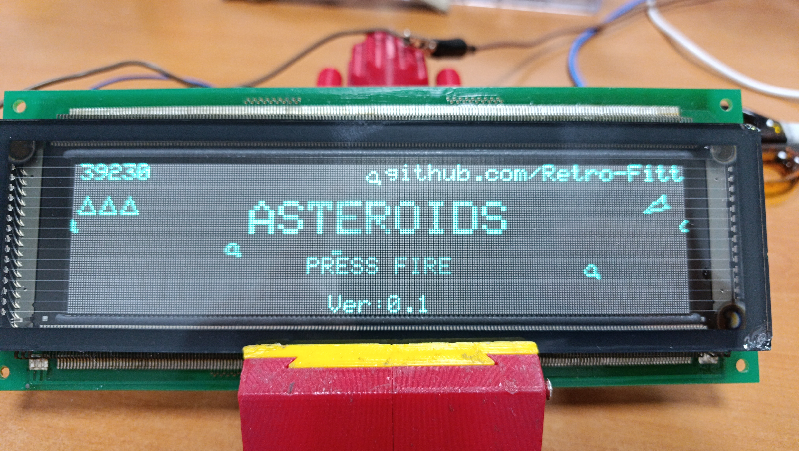
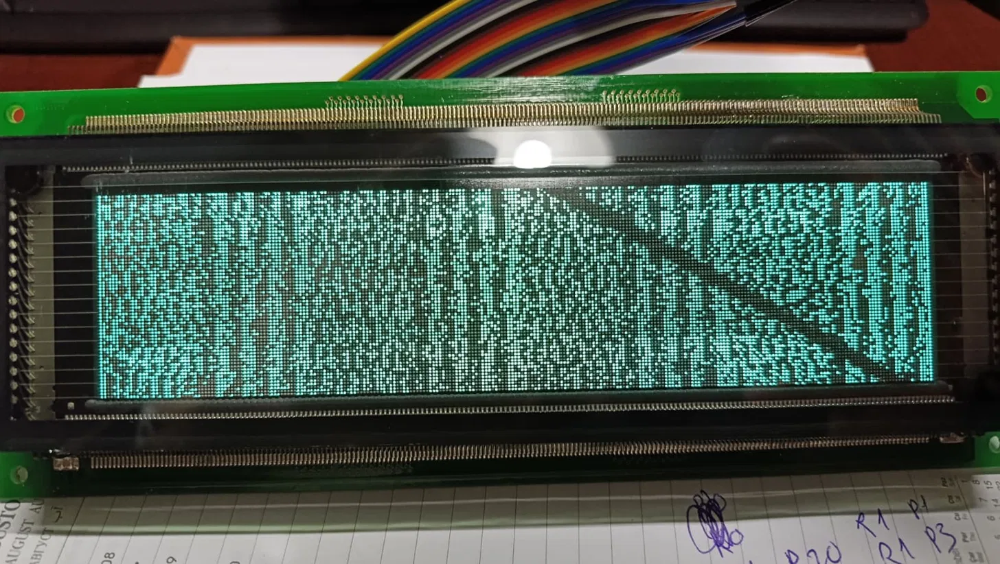
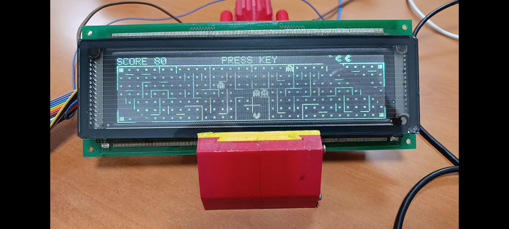

# Futaba-GP1045A01A-256-64-VFD-Retrofit
# Futaba GP1045A01A 256×64 VFD — reverse-engineered, tamed with an Arduino Uno, and made to play Pac-Man

> *A mystery vacuum-fluorescent display from a classifieds site, no datasheet, a multimeter, a pile of 10 kΩ resistors,
> and a lot of staring at random noise. Now it plays Asteroids, Pac-Man and Space Invaders.*



*The Asteroids attract screen on the real module, driven by an Arduino Uno.*

This repository documents how the pinout and the protocol of a **Futaba GP1045A01A** graphic VFD module
(board marking `1P00A293-01 Rev.C`, 256 × 64 dots, green) were found **without a datasheet**, and contains
everything needed to drive it from an **Arduino Uno**:

| Folder | What it is |
|---|---|
| [`VFD_Probe/`](VFD_Probe) | The discovery/test tool: read the RAM back, print text, poke commands, walk data lines |
| [`VFD_Asteroids/`](VFD_Asteroids) | Vector **Asteroids** with UFOs, engine flame, demo mode (30 fps) |
| [`VFD_Pacman/`](VFD_Pacman) | **Pac-Man** with random mirrored mazes, 4 ghosts with personalities, demo AI (30 fps) |
| [`VFD_Invaders/`](VFD_Invaders) | **Space Invaders** with erodible shields, UFO bonus, demo AI (30 fps) |
| [`VFD_Hardware/`](VFD_Hardware) | KiCad schematic of the wiring (Uno ↔ module connector, pull-ups) |
| [`FUTABA_VFD_3D/`](FUTABA_VFD_3D) | A 3D-printable front bezel for the module (STL + Autodesk Inventor sources) |

---

## TL;DR — the pinout

The module has a **2 × 13 pin header (J1)**. Pin 1 is marked on the PCB; odd pins are one row, even pins the other.

| J1 pin | Function | Uno pin | How we know |
|:---:|---|:---:|---|
| 1 | **D7** (data bit 7) | D2 | write → read back |
| 3 | D6 | D3 | " |
| 5 | D5 | D4 | " |
| 7 | D4 | D5 | " |
| 9 | D3 | D6 | " |
| 11 | D2 | D7 | " |
| 13 | D1 | D8 | " |
| 15 | **D0** | D9 | " |
| 17 | **WR** (write, latches on the *rising* edge) | A0 | read-back test, only one combination works |
| 19 | **C/D** (HIGH = command, LOW = data) | A1 | write/read verification |
| 21 | **RD** (keep HIGH when writing) | A2 | read-back test |
| 23 | **CS** (chip select, active LOW) | A3 | read-back test |
| 25 | **INT** (output: one pulse per display frame) | A5 (optional) | ~75 µs pulse every ~10.3 ms, matches the GP9002A "INT" description |
| 26 | **SEL** (HIGH/open = parallel, **LOW = serial mode!**) | A4 (optional) | GP9002A document + behaviour (pulling it low blanks the display) |
| 24 | not connected | — | |
| 2, 4, 6 … 16 | GND | GND | multimeter |
| 18, 20, 22 | **+5 V** | external 5 V | multimeter |

Notes:

* **Data order is reversed**: connector pin 1 is D7, pin 15 is D0.
* Every signal pin (1–23 odd, and 26) has a **10 kΩ pull-up to VCC on the module** (that is how we found them). Pin 25 (INT) is an output and has none.
  That means **RD and SEL do not strictly need an Arduino pin**: leaving them unconnected keeps them HIGH.
* Put a **330 Ω series resistor** into each Arduino → module signal line while experimenting. A wrong guess on a bus pin then
  becomes a shrug instead of a smoke signal.
* **Power the module from its own 5 V supply** (≥ 2.5 A recommended) and connect the grounds. It draws ~1.2 A idle and
  several times that for a moment at switch-on (DC/DC converter + filament).

```
 J1 (looking at the header, pin 1 = marked corner)

   pin  1  D7   ■ ■  GND  pin  2
   pin  3  D6   ■ ■  GND  pin  4
   pin  5  D5   ■ ■  GND  pin  6
   pin  7  D4   ■ ■  GND  pin  8
   pin  9  D3   ■ ■  GND  pin 10
   pin 11  D2   ■ ■  GND  pin 12
   pin 13  D1   ■ ■  GND  pin 14
   pin 15  D0   ■ ■  GND  pin 16
   pin 17  WR   ■ ■  VCC  pin 18
   pin 19  C/D  ■ ■  VCC  pin 20
   pin 21  RD   ■ ■  VCC  pin 22
   pin 23  CS   ■ ■  n.c. pin 24
   pin 25  INT  ■ ■  SEL  pin 26
```

---

## The protocol: it is a Futaba GP9002A

The control ASIC (a custom Futaba `5P23A013-02`) speaks essentially the command set of the **GP9002A01A** 128×64 module
(Futaba application note **AN-E-3237A**, see [References](#references)), scaled up to 256×64 — with a few surprises.

### Bus cycle

| Signal | Command write | Data write |
|---|---|---|
| C/D | HIGH | LOW |
| CS | LOW | LOW |
| RD | HIGH | HIGH |
| WR | pulse LOW → HIGH, **the byte is taken on the rising edge** | same |

Keep **SEL HIGH** (or open). Pull SEL low and the module switches to the synchronous serial interface and ignores the bus.

### Commands that were verified on this module

| Command | Data | Meaning | Status |
|:---:|:---:|---|---|
| `00H` | – | display **off** | ✔ |
| `01H` | – | display **on** (1st screen) | ✔ |
| `02H` | – | 2nd screen on | ✔ (switches the display on) |
| `08H` | bytes… | write display data (address auto-increments) | ✔ |
| `09H` | – | read display data (first byte read is a dummy) | ✔ |
| `0EH` / `0FH` | lo / hi | RAM address low 8 bits / high 3 bits (0 … 0x7FF) | ✔ |
| `11H` | – | show XOR of both screens (identical start addresses → black) | ✔ (this is what gave the family away) |
| `14H` | `10H` | display mode: no gray scale | ✔ send it first |
| `06H` | – | "clear screen" | ✘ **does nothing** — clear the RAM yourself |
| `13H` | `00H`…`FFH` | luminance | ⚠ appears **inverted**: `13H,00H` turns the picture off, `FFH` is full brightness |
| `15H` | – | INT mode | ✘ no visible effect on the INT pin |
| `20H` … `24H` | – | built-in character generator (GP9002A has one) | ✘ not present |

### Memory map

* 2048 bytes: `address = x*8 + y/8` with `x = 0 … 255` and `y = 0 … 63`.
* In each byte **bit 7 is the TOP pixel** of its 8-pixel vertical block, bit 0 the bottom one.
* Address auto-increments after each data write, so a whole column of 8 bytes (or the whole screen) streams in one burst.

### Initialisation sequence that works

```
wait ~1.5 s after power-up            (the module needs time to wake up)
SEL = HIGH, RD = HIGH, CS = HIGH, WR = HIGH
14H, 10H                              display mode: no gray scale
00H                                   display off while writing
0EH,00H, 0FH,00H, 08H, 2048 × 00H    clear the RAM by hand (06H does not work!)
… draw your picture …
01H                                   display on
```

If you send `01H` **before** the RAM was written you get a screen full of random dots. That is the power-on RAM content, not a
fault:



*The screen right after switching it on and sending `01H`: not a bug, that is the module's RAM saying hello.*

### Timing — the module drops bytes if you are too fast

| Byte-to-byte time | Result (measured on this unit) |
|:---:|---|
| ≈ 1.6 µs | ❌ picture turns to garbage (bytes dropped) |
| ≈ 1.9 µs | ✅ works |
| ≈ 2.5 µs | ✅ used as the default in the games (≈ 30 % margin) |

The datasheet-style "600 ns minimum" of the GP9002A is **too optimistic** for this module. The Asteroids sketch has a
run-time knob for it: send `]` (faster) / `[` (slower) on the serial monitor.

### Minimal driver (portable, `digitalWrite` based)

```cpp
const uint8_t DP[8] = {2, 3, 4, 5, 6, 7, 8, 9};   // J1 pin 1 ... 15  = D7 ... D0 (reversed!)
const uint8_t WR = A0, CD = A1, RD = A2, CS = A3, SEL = A4;

void vfdWrite(bool isCommand, uint8_t v) {
  for (uint8_t i = 0; i < 8; i++) digitalWrite(DP[i], (v >> (7 - i)) & 1);   // pin 1 = bit 7
  digitalWrite(CD, isCommand);
  digitalWrite(CS, LOW);  digitalWrite(WR, LOW);  delayMicroseconds(2);
  digitalWrite(WR, HIGH); digitalWrite(CS, HIGH); delayMicroseconds(10);       // rising edge of WR latches the byte
}
void setAddr(uint16_t a) { vfdWrite(1, 0x0E); vfdWrite(0, a & 0xFF); vfdWrite(1, 0x0F); vfdWrite(0, a >> 8); }

void setup() {
  for (uint8_t i = 0; i < 8; i++) pinMode(DP[i], OUTPUT);
  pinMode(WR, OUTPUT); pinMode(CD, OUTPUT); pinMode(RD, OUTPUT); pinMode(CS, OUTPUT); pinMode(SEL, OUTPUT);
  digitalWrite(WR, HIGH); digitalWrite(RD, HIGH); digitalWrite(CS, HIGH); digitalWrite(SEL, HIGH);
  delay(1500);
  vfdWrite(1, 0x14); vfdWrite(0, 0x10);               // no gray scale
  vfdWrite(1, 0x00);                                   // off while writing
  setAddr(0); vfdWrite(1, 0x08);
  for (uint16_t i = 0; i < 2048; i++) vfdWrite(0, 0x00);   // "clear" (06H does not work)
  setAddr(0 * 8 + 0); vfdWrite(1, 0x08); vfdWrite(0, 0xFF); // a vertical 8-pixel bar at x = 0, y = 0..7
  vfdWrite(1, 0x01);                                   // display on
}
void loop() {}
```

---

## How the pinout was found (the honest version, with detours)

The module was bought cheaply from a local seller. It has a 2×13 pin box header, six `NEC D16306A6F` drivers, a
`BR6265BF-10SL` (looks like a static RAM) and a custom Futaba chip `5P23A013-02`. The only datasheets that could be found were for
*siblings*: **GP1045A13A** and **GP1045A09A** (same 256×64 glass but with RS-232 and an ESC-sequence protocol), **M404SD01BA**
(a character module with a similar-looking 26-pin connector) and the **GP9002A** (128×64, parallel). A fine collection of
"almost".

### Chapter 1 — trust nobody, bring a multimeter

* Continuity to ground on the **even pins 2–16** → ground. Pins **18, 20, 22** → supply.
* The **odd pins 1–23 each have a 10 kΩ resistor to the supply rail**. Twelve pulled-up lines = **8 data + 4 control**
  (and later two more: pin 26 also has a pull-up, pin 25 does not).
* Supply voltage? No RS-232 level shifter on the board and the pull-ups go straight to VCC, so the logic is 5 V. It was
  powered with a current-limited 5 V supply: ~1.2 A idle, no smoke. A very good start.
* Nothing lit up at power-up. *(Foreshadowing: the GP9002A family powers up with the display off and waits for `01H`.)*

### Chapter 2 — brute force with a safety net

Hypothesis: D0–D7 on pins 1…15, and WR/RD/CS/C/D on 17/19/21/23 in some order. That is 24 permutations × 2 data orders = **48
combinations**. The Uno tried all of them, each line through a 330 Ω resistor, sending a GP9002A-style initialisation, a
fill pattern and `01H` ("display on") at the end.

The screen lit up in exactly **four** combinations (`R1 P1`, `P3`, `P20`, `P22` in the lab notebook). Decoding them gave:

* the **data order is reversed** (pin 1 = D7) — the non-reversed order never worked;
* **{17, 23} = {WR, CS}** (they were always pulsed together, so which is which stayed open for a while);
* {19, 21} = {C/D, RD}, in an unknown order.

The picture was full of random dots. Success! (It was only noise. But it was *our* noise.)

### Chapter 3 — the command scan

Sending single bytes `0x02 … 0x2F`: **only `11H` and `15H` did anything** (display off), and `00H`/`01H` were
off/on. `11H` is "show the XOR of screen 1 and 2" in the GP9002A — two identical screens XOR to black. That was the first hint that the ASIC
really *is* GP9002A-flavoured. But `06H` ("clear") did nothing, and every attempt to write real data failed...

### Chapter 4 — the wrong turns (a.k.a. "the hypothesis hall of fame")

| We believed | Reality |
|---|---|
| **C/D is on pin 19 or 21, we just need to find out which** | It *is* pin 19, but our tests kept failing for *other* reasons (see below). |
| Pins **17/23 = WR/SEL, 19/21 = RESET/BLANK/TEST** (the M404SD01BA datasheet has exactly 14 signals, just like our 14 pins!) | A beautiful theory that fit like a glove — and was **wrong**. |
| **Pin 25 is BUSY** | It is **INT**: it pulses by itself ~100 times a second whether you write or not. |
| **Pin 26 is BLANK** (pulling it low blanked the screen) | It is **SEL**. Low = serial mode, and the module stops listening. "Blank" was a side effect. |
| The commands are broken because the data lines are wrong / bit 2 is dead | The data bus was fine. **`06H` is simply not a working clear command** on this module. |
| The ESC-sequence protocol of the RS-232 siblings (`ESC [ 2 J` …) | Not on this chip. We even tried it, politely. |

Moral: **a hypothesis that fits all your evidence is still just a hypothesis.** We later found a document that fitted even better.

### Chapter 5 — reading the datasheet of the *right* sibling

The GP9002A application note (hosted by Adafruit) describes an **INT output: "one pulse per display frame"**, a **SEL pin
(open = parallel, GND = serial)**, `CS/WR/RD/C-D` — and the command table with `00H/01H/02H`, `0EH/0FH`, `08H/09H`, `10H–12H`, `14H`.
Our mystery pin 25 pulsed for ~75 µs every ~10.3 ms; the document says 65 µs every 8.4 ms for the smaller display. Same
behaviour, bigger glass. **Jackpot.**

### Chapter 6 — the trick that cracked it: *read the RAM back*

Looking at noise on the screen is a lousy way to debug. A much better idea: the GP9002A can **read** its RAM (`09H`, then
pulse `RD` with `C/D` low). If the module drives the data bus with real content, you know you got the control lines right —
and you do not even need to look at the screen.

The read-test tried the four possible CS/WR/C-D/RD assignments. Exactly **one** of them returned a stream of changing bytes
(`FF C3 FF 8E FE 67 D7 26 …` — the random power-on RAM); the three wrong ones returned a constant `5F`, `FD` or `FF`.
That was the moment we **knew**: `CS = 23, WR = 17, C/D = 19, RD = 21`.

Then the full loop: write `11 22 33 44 55 66 77 88` → read back `11 22 33 44 55 66 77 88`. ✔ The data bus, the bit order, the
addressing — all correct. `06H` still did not clear the RAM, so the "clear screen" became *"write 2048 zeros"*.

### Chapter 7 — which way is up?

First picture: a one-pixel frame around the border. The vertical lines landed exactly on the edges, the horizontal ones
**7 pixels inside** — which means **bit 7 of a byte is the top pixel**, not bit 0. Fixed in one line. Then the first
real text appeared on the screen and everyone was happy.

### Chapter 8 — the games, and the speed limit

With a working bus the rest was "just" programming: **Asteroids**, **Pac-Man**, **Space Invaders**. Lessons learned on the way:

* The Uno's RAM (2 KB) is exactly as big as the display's RAM (2 KB). A full frame buffer is impossible, so the games compose the screen in
  **8 strips of 32 columns** (Asteroids/Invaders) or rewrite only the **cells that changed** (Pac-Man).
* An obvious "optimisation" that wrote bytes every 1.6 µs produced beautiful garbage. The module has a **speed limit** (see above).
* A big part of one game's frame time went into a software **division** per pixel in the big title text. Division on an 8-bit AVR: just do not.

### Chapter 9 — the screen that went dark after a minute

Everything worked, and then the display switched off after about a minute while the Uno happily kept printing `fps=30`. We suspected the ASIC resetting, power
supply sag, noise on the bus, a cosmic ray and finally the software. We even added a "re-send *display on* every two seconds" workaround.

It was a **cold solder joint in the power-supply connection**. The only bug that does not compile. (The workaround was removed again.)

---

## The sketches

All sketches target an **Arduino Uno** (ATmega328P). They use direct port access for speed, so they are **not** drop-in on other
boards (see the note on the Mega below). Open the `.ino` in the Arduino IDE, select *Arduino Uno*, upload. Serial monitor:
115200 baud (with *Newline* line ending).

### Controls

The games work with **four buttons to GND** (internal pull-ups, no resistors needed) or a 4-way digital joystick:

| Game | D10 | D11 | D12 | D13 |
|---|---|---|---|---|
| Asteroids | left | right | thrust | fire |
| Space Invaders | left | right | fire | fire |
| Pac-Man | left | right | up | down |

They can also be played from the serial monitor (send with Enter): `a`/`d`/`w`/`s`/`f` (see the header of each sketch).
With **no input at all, each game plays itself** (attract/demo mode) — handy for testing the display without any buttons. Any
button or key starts a real game.

### VFD_Asteroids

Vector graphics with 3 asteroid shapes × 3 sizes that split when shot, screen wrap-around, large and small **UFOs**
(the small one aims at you and gets better with your score), a V-shaped **engine flame** with sparks, particle explosions.
Shows `Ver:x.y` and the project address on the attract screen. Prints timing on the serial monitor
(`ms/frame: update / compose / flush`); `]` and `[` tune the VFD write speed at run time.

Frame time budget at 30 fps: ≈ 0.6 ms game logic + 6–16 ms drawing + 3–6 ms writing to the VFD.


### VFD_Pacman

A 32 × 7 cell maze (8 × 8 px cells, 1 px thin walls) **generated randomly for every level**: randomised depth-first search on the left half,
extra loops, dead ends removed, mirrored to the right half, wrap-around tunnel in the middle row. Four ghosts with Pac-Man-style targeting
(chaser, ambusher, flanker, shy one) plus scatter/chase phases, power pellets, frightened/eaten ghosts, combo scores, levels. The
generator was checked on 2000 random mazes: every cell reachable, perfectly symmetric, no dead ends.



*Pac-Man in demo mode (the AI is playing). Top row: score, message, lives. The maze is generated anew for every level.*

### VFD_Invaders

4 × 11 invaders with two animation frames (squid, crab, octopus), they speed up as they die, four **shields that erode pixel by pixel**
(from both sides, and by the invaders themselves), UFO bonus (50/100/150/300), enemy bullets that sometimes aim at you, levels.

### VFD_Probe

The tool this whole project started with. Type `?` on the serial monitor. Handy commands:

| Command | What it does |
|---|---|
| `z` | clear the RAM and switch on (black screen) |
| `t` | border test: shows the address layout and the bit order |
| `P HELLO` | print text (`P 2 …`, `P 3 …` = bigger, `\|` = new line) |
| `R` | **RAM read test** — tries the 4 CS/WR/C-D/RD assignments and prints the bytes read |
| `v` | write/read verification without looking at the screen |
| `k 14` / `y 10` | send a command byte / data byte (hex) |
| `w`, `p` | walk single / pairs of data lines (how the bit order was verified) |
| `m` | watch pin 25 (INT) |
| `l n` / `h n` | hold control line *n* LOW / release it HIGH |

---

## Hardware

* [`VFD_Hardware/`](VFD_Hardware) — KiCad project: the Arduino Uno connected to the module header **J1** with the 12+1 pull-up resistors
  as found on the module. Only the schematic is used; there is no PCB (the `.kicad_pcb` is an empty stub).
* [`FUTABA_VFD_3D/`](FUTABA_VFD_3D) — front bezel for the module (≈ 220 × 90 × 19.5 mm), `VFD_FRONT.stl` is ready for printing; the
  Inventor part/assembly files are the sources.

### Safety notes

* The DC/DC converter on the module produces about **55–64 V DC**. Do not touch the electronics while it is powered, and wait **30 seconds** after switching off
  (the capacitors discharge slowly). Do not short components within that time.
* **Never plug or unplug** the signal cable with the power on.
* The glass is glass. Handle it gently, and keep the signal cable shorter than ~30 cm.
* Power-on current is **5–10 ×** the idle current: use a supply that can deliver a few amps and a solid, **well-soldered**
  connection (see Chapter 9).
* All signals are **5 V logic**. Do not drive the module from a 3.3 V MCU without level shifting (it wants ≥ 0.7 × VCC for a HIGH).

### Troubleshooting

| Symptom | Probable cause |
|---|---|
| Nothing at all after power-up | Normal! The display starts **off**. Send `01H` after writing the RAM. |
| Screen full of random dots | The RAM was never written (power-on content). Write the whole RAM before sending `01H`. |
| Picture is garbled / random pixels | Bytes written too fast (< ~1.9 µs apart) or reversed data order. |
| `06H` does not clear | Right, it does not. Write zeros. |
| Display switches off after a while | Check the power connection (cold solder joint…). |
| Display goes blank when you touch pin 26 | Pin 26 = SEL. Low = serial mode. Keep it HIGH/open. |
| Everything is fine but text is mirrored/upside down | Check the data order: J1 pin 1 = D7, and bit 7 = top pixel. |

### Using a different Arduino

The games write the data bus through the **ATmega328P port registers** (`PORTD`, `PORTB`, `PORTC`). On an Arduino Mega those ports are
connected to completely different pins, so wiring the module to "the same pin numbers" will **not** work with these sketches. The
Mega has a full 8-bit port (PORTA = D22…D29) that would be perfect for the data bus, but the port macros need to be changed. The
slower `VFD_Probe` uses `digitalWrite` and works on any board with 5 V I/O.

---


## References

* Futaba **GP9002A01A application note AN-E-3237A** — the document that describes this module's command set (not this exact module):
  [Adafruit mirror (PDF)](https://cdn-shop.adafruit.com/datasheets/GP9002A%20Appnote.pdf),
  [Mouser datasheet page](https://www.mouser.com/datasheet/2/921/Futaba-04-20-2020-GP9002A01A-1839366.pdf).
* [Adafruit Learning System: Graphic 128×64 VFD](https://learn.adafruit.com/graphic-128x64-vfd) — a friendly introduction to the GP9002A.
* Related Futaba documents that were consulted but turned out **not** to describe this module's protocol:
  **GP1045A13A** (5 V, RS-232, ESC sequences), **GP1045A09A** (24 V, RS-232), **M404SD01BA / AN-E-2215B**
  (character module with a similar-looking 26-pin connector, a different 14-signal interface).

## Disclaimer

This is a hobby reverse-engineering project. It is **not affiliated with or endorsed by Futaba**; product names are trademarks of their
owners. The pinout and protocol were derived by experiments on a single module; another unit or revision may behave differently.
High voltage is present on the module. Use at your own risk — and keep your solder joints warm.

---

